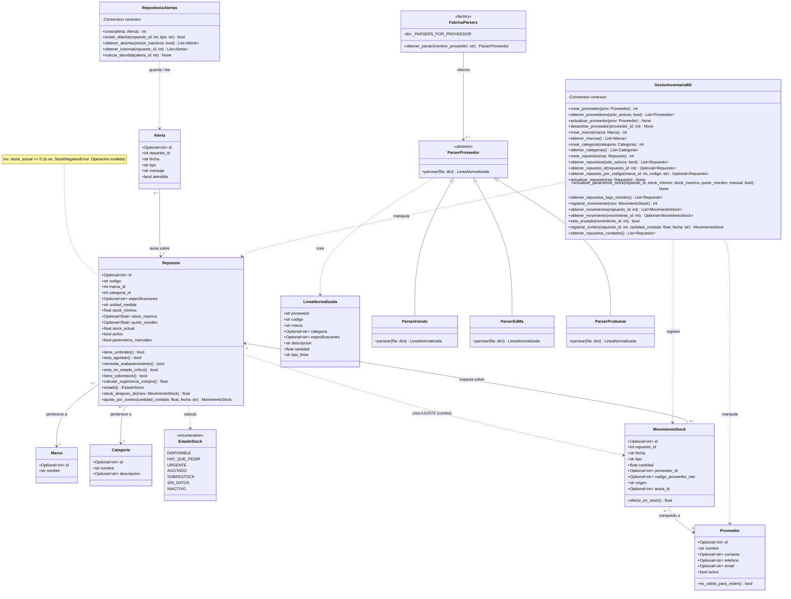
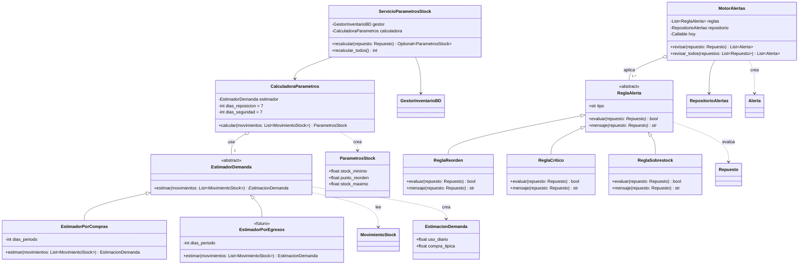
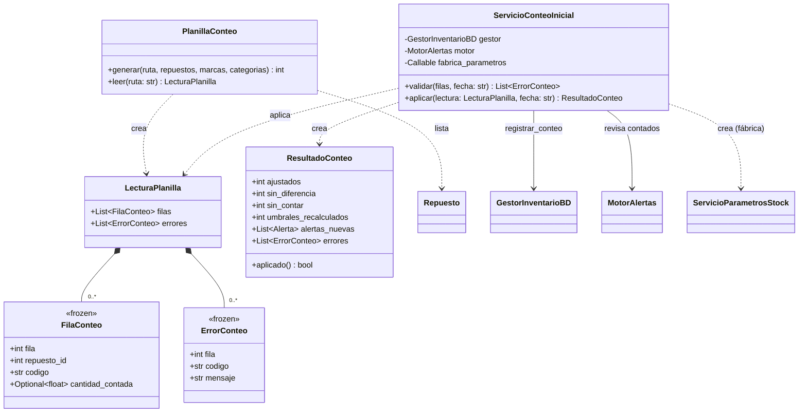
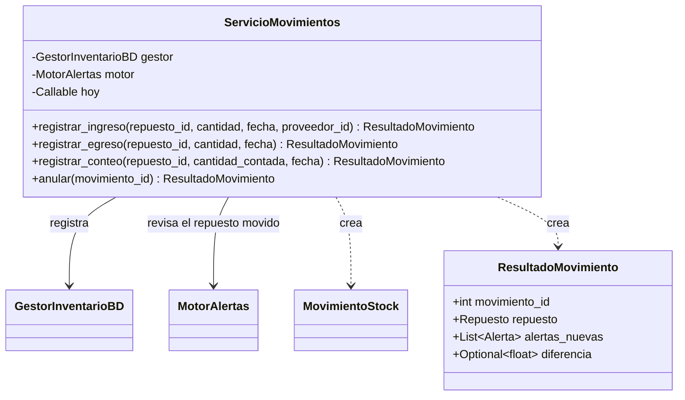
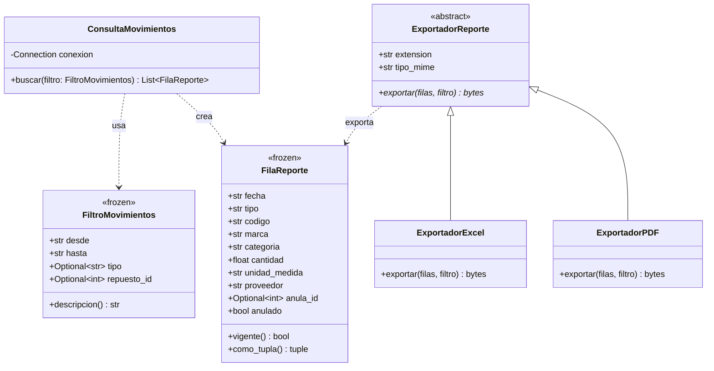
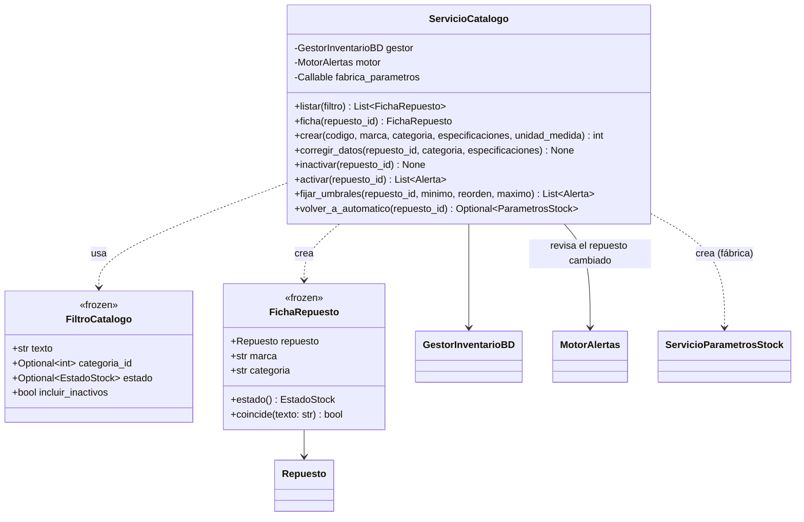
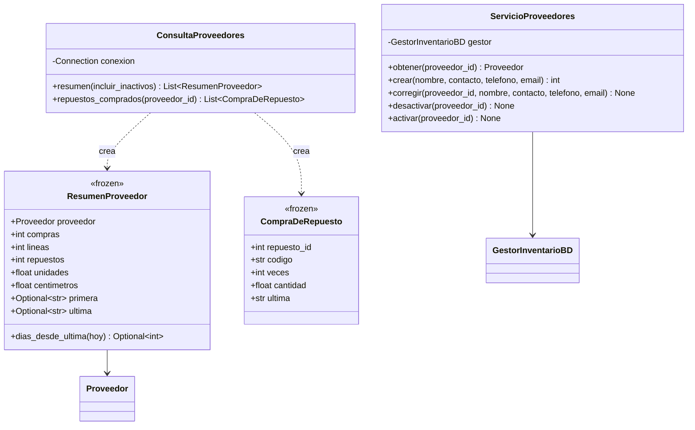
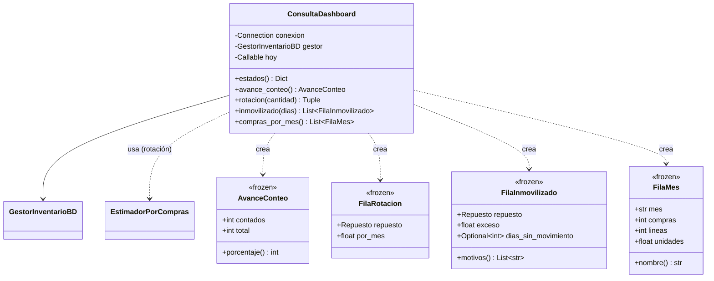

# 📐 Diagrama de Clases UML — Gestor de Inventario

> Actualizado el 20/10/2026: modelo de repuestos con `codigo` (marca + código), categorías unificadas, `LineaNormalizada`, **módulo de alertas**, **conteo inicial** con planilla y **registro de movimientos**, **historial con descargas**, **catálogo**, **proveedores** y **dashboard**.
> La misma información está en `diagramaUML.puml` (PlantUML) y en la imagen `Diagrama_Clases_Gestor_Stock.png`.

**Notación** (Unidades 2 y 3 de POO): `+` público, `-` privado, `*` método abstracto, `<<abstract>>` clase abstracta (ABC).
Relaciones: `<|--` herencia ("es un"), `o--` agregación ("tiene un", la parte existe por fuera), `*--` composición (la parte vive y muere con el todo), `-->` asociación ("usa un"), `..>` dependencia ("depende de").

## 1. Modelo de dominio, persistencia y parsers

## 2. Módulo de alertas (`modules/alertas.py`) — diseño

Las clases `Repuesto`, `MovimientoStock`, `Alerta`, `GestorInventarioBD` y `RepositorioAlertas` del segundo diagrama son las mismas del primero; se repiten solo como referencia de las relaciones.

## 3. Conteo inicial con planilla (modules/conteo.py)

`PlanillaConteo` solo conoce el formato del Excel; `ServicioConteoInicial` coordina el conteo (todo o nada), recalcula umbrales y revisa las alertas de los repuestos contados. `*--` es composición: las filas y los errores existen solo dentro de una lectura.

## 4. Movimientos del día a día (modules/movimientos.py)

`ServicioMovimientos` valida cada ingreso, egreso o conteo (precondiciones), lo guarda y revisa las alertas **solo del repuesto movido**. La pantalla "Registrar movimiento" (`apps/app_1.py`) lo usa sin agregar reglas propias.

## 5. Historial y descargas (modules/reportes.py)

`ConsultaMovimientos` solo lee. Los exportadores son otra vez el patrón **Strategy**: la pantalla elige `EXPORTADORES["excel"]` o `EXPORTADORES["pdf"]` y llama a `exportar()` sin saber cuál es. Un formato nuevo (CSV) sería una clase más.

## 6. Catálogo (modules/catalogo.py)

`ServicioCatalogo` coordina el alta y la corrección de repuestos, activar/inactivar (solo sin stock) y los umbrales a mano. Después de cada cambio que puede afectar el estado, revisa las alertas de ese repuesto.

## 7. Proveedores (modules/proveedores.py)

`ConsultaProveedores` solo lee (a quién se le compra y qué); `ServicioProveedores` da de alta, corrige y activa/desactiva con sus reglas. No hay precios todavía: la comparación es por frecuencia.

## 8. Dashboard (modules/dashboard.py)

`ConsultaDashboard` arma los números (solo lee); la pantalla los dibuja con barras en HTML/CSS. La rotación reutiliza `EstimadorPorCompras` del módulo de alertas.

